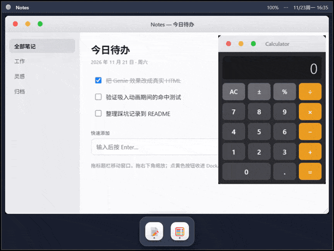
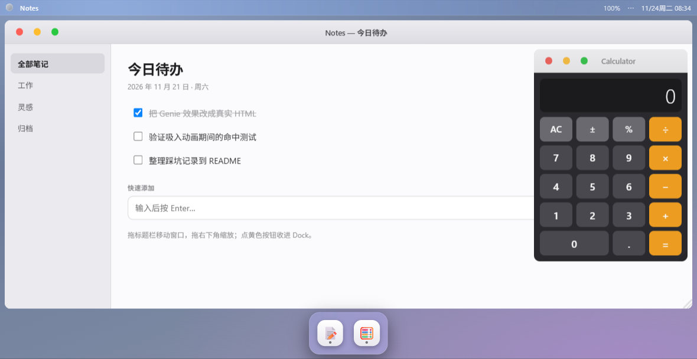
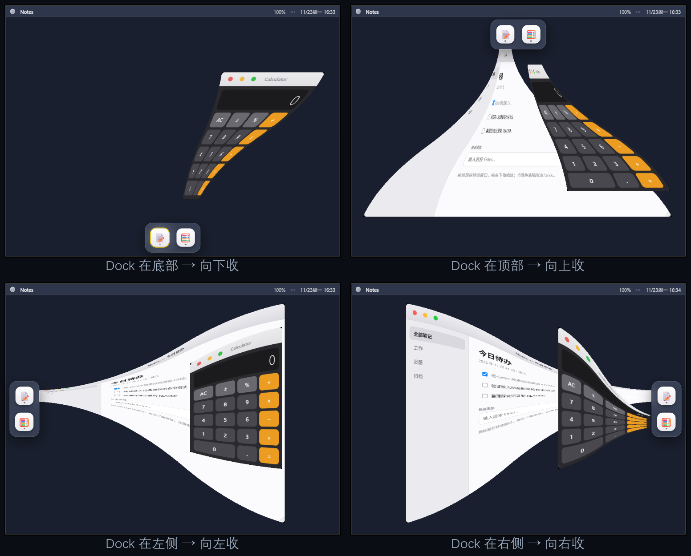
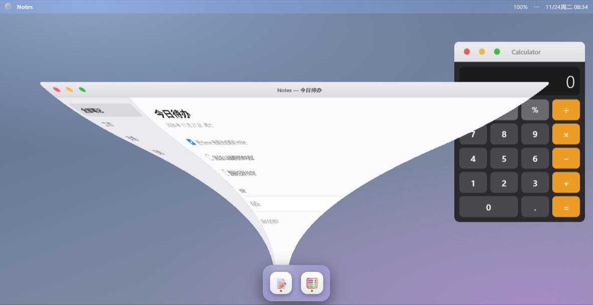
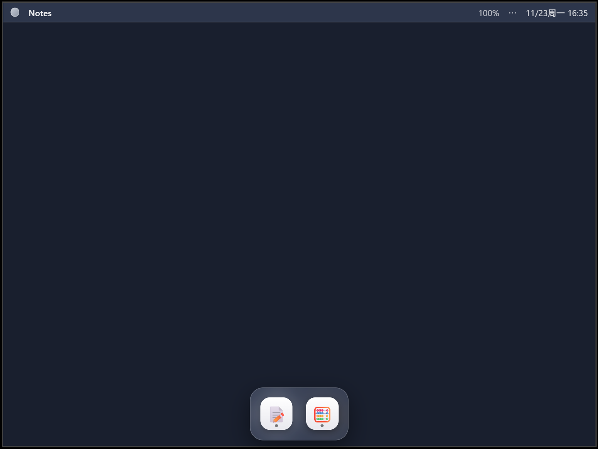

# MacOS Genie Effect with WebGPU

在浏览器里复现 macOS 经典的窗口最小化动画（Genie Effect）：窗口被「吸进」Dock 时
两侧向内收、内容被压缩着流向图标。窗口内容是**真实的 HTML**，由 HTML-in-Canvas
捕获成 GPU 纹理，形变全部在 WGSL 片元着色器里逐像素完成。



公式与两段时序来自 [Harshil Shah - Introducing Pause](https://harshil.net/blog/introducing-pause) 描述的网格形变模型。

## 能做什么

- **真实桌面**：菜单栏 + 两个 App 窗口（Notes / Calculator）+ Dock
- **窗口可交互**：拖标题栏移动、拖右下角缩放、三个交通灯（关 / 最小化 / 最大化）
- **Dock 可交互**：点图标最小化 / 还原对应窗口，还原时 genie 反向播放；Dock 可换到四条边
- **计算器真的能算**：四则运算 / 百分比 / 正负号，除零显示 `Error`
- **方向由 Dock 位置决定**：Dock 停底/顶/左/右，窗口就往对应方向收
- **内容压缩而非裁剪**：终点落成 Dock 图标大小并留在屏幕上



## 环境要求

- Node.js 22.6+（纯函数测试直接用 Node 的类型剥离加载 `.ts`，无需构建步骤）
- pnpm（或 npm / yarn）
- 支持 HTML-in-Canvas 的浏览器：Chrome 155+；或 Chrome 138+ 并开启
  `chrome://flags/#canvas-draw-element`

## 快速开始

```bash
pnpm install
pnpm dev        # http://localhost:5201 （vite.config.ts 里 strictPort: true）
```

```bash
pnpm build      # tsc && vite build → dist/
pnpm preview    # 预览构建结果
```

## 项目结构

```
index.html                      页面：canvas[content=drawable] + 两个 App 窗口 + 菜单栏 + Dock
src/
├── main.ts                     GenieApp：多窗口渲染、DPR、拖拽/缩放/交通灯/Dock/菜单栏
├── app-window.ts               单窗口封装：纹理 + uniform + 几何 + 最小化状态
├── genie.ts                    纯计算：uniform 打包 + 可见包围盒（不依赖 WebGPU）
├── html-in-canvas.ts           HTML-in-Canvas 封装 + 三代 API 降级 + 几何同步
├── style.css                   样式
├── wgsl.d.ts                   WGSL 模块类型声明
└── shaders/effect/
    ├── Genie.vertex.wgsl       顶点：像素 → NDC（6 顶点，覆盖 源∪目标 并集）
    └── Genie.fragment.wgsl     片元：逆映射（贝塞尔收窄 + 内容压缩）+ discard
scripts/
├── genie-check.mjs            纯函数测试（node scripts/genie-check.mjs）
├── check.mjs                  CDP：交互回归 + 截图 + 控制台报错
└── dpr-check.mjs              CDP：DPR 1/2/3 尺寸校验
```

## 实现

### 1. 真实 DOM 变成纹理

canvas 用 `content="drawable"`，窗口带 `drawable` 属性，因此它参与布局、可点击、
可输入、对屏幕阅读器可见。每个窗口通过 `queue.drawElementImageToTexture`
（旧版为 `copyElementImageToTexture`，见 `src/html-in-canvas.ts` 的三代降级）
写进自己的一张 `rgba8unorm` 纹理。

⚠️ 菜单栏和 Dock 是 canvas 的**兄弟节点**，不是子节点 —— 否则会被一起捕获进
窗口纹理，跟着窗口一起变形。

### 2. 一次四边形 + 片元逆映射

几何只有一个覆盖「源 ∪ 目标」并集的四边形。曲线不靠细分网格逼近，而是在片元里
对每个像素反算纹理坐标。这套公式来自 K.md 的网格模型（1 列 × N 行）：

```wgsl
// 每行的两侧边距（沿行进方向 a）
e   = easeInOutQuad((a - toALo) / (fromALo - toALo))
lo  = mix(mix(fromPLo, toPLo, slide), fromPLo, e)
hi  = mix(mix(fromPHi, toPHi, slide), fromPHi, e)
```

片元要回答的是**反问题**：屏幕上这个像素该采样纹理的哪一点？

1. 把像素投影到 `(dir, perp)` 局部坐标系，得到 `(a, c)`
2. `a` 落在当前行进带 `[bandLo, bandHi]` 之外 → `discard`
3. 由 `a` 反解 `e`，算出该行的 `lo / hi`
4. `c` 落在 `[lo, hi]` 之外 → `discard`（漏斗外）
5. 归一化后回查源矩形，得到纹理坐标

### 3. 方向由 Dock 位置决定

**没有「方向下拉框」** —— 方向是 Dock 停靠位置的函数，和真实系统一致：

| Dock 停靠    | 窗口怎么收                | 行进轴  |
| ------------ | ------------------------- | ------- |
| 底部（默认） | 往下收进 Dock             | `down`  |
| 顶部         | 往上收进菜单栏下方的 Dock | `up`    |
| 左侧         | 往左收进**垂直** Dock     | `left`  |
| 右侧         | 往右收进**垂直** Dock     | `right` |

左右两侧的 Dock 是纵向排列（类似 GNOME），窗口也跟着让出侧边空间。
切换在控制区的「Dock 位置」下拉里，切换后：

1. Dock 用 CSS transition 移到对应边、切换排列方向
2. `visibleFrame()` 按 Dock 实际占位重新计算可用区域
3. 所有窗口重新布局，且**永远不会盖住菜单栏和 Dock**

底层只有 4 个行进方向，`dir` 是单位向量，`perp = (-dir.y, dir.x)`。
没有斜向 —— 真实 macOS 里漏斗永远沿屏幕的一条主轴收窄。



### 4. 全屏 ≠ 铺满屏幕

macOS 的「全屏」**并不铺满整个屏幕**：菜单栏常驻顶部、Dock 常驻底部，
窗口只占中间的 visible frame。真正铺满（连 Dock 都盖住）在系统里是另一个东西
——「全屏空间」（Full Screen Space），那种模式不会有 genie 最小化动画。

所以本项目的 `full` 模式 = 窗口最大化到 visible frame：

```ts
const top = MENUBAR_H + 8;
const availH = H - top - DOCK_AREA;   // visible frame
```

`visibleFrame()` 同时被拖拽边界、缩放上限、绿灯最大化复用，
保证窗口永远不会盖住菜单栏和 Dock。

另有三种布局模式可切换：`full`（最大化）/ `windowed`（居中 68%）/ `offset`（偏左上）。

### 5. 两个阶段（有重叠）

| 阶段         | 时间      | 干什么                                   |
| ------------ | --------- | ---------------------------------------- |
| 曲线 `slide` | 0 → 0.5   | 两侧边距从源矩形插值到目标矩形，形成漏斗 |
| 位移 `trans` | 0.4 → 1.0 | 行进带两端朝目标收缩                     |

两段在 **0.4 ~ 0.5 重叠 0.1**，这正是 K.md 里「液体流过漏斗」的连贯感来源。
动画总时长 `animationDuration` = 1.0s。



### 6. 内容是被压缩，不是被裁掉

这是与旧实现最本质的差异：

- **旧版**：`uv.y' = uv.y - tp` + `discard` → 内容 1:1 采样，顶部整条被裁，
  进度 1 时可见高度为 0，窗口**完全消失**
- **现在**：整条内容被**压缩**进逐渐变短的带子，进度 1 时落成 Dock 图标大小，
  **仍然可见**



### 7. CPU 与 GPU 保持一致

`src/genie.ts` 是着色器的 CPU 镜像，两者必须逐字对齐：

- `computeGenieFrame`：推导一帧的全部正向参数（方向、投影区间、行进带、两段进度）
- `packGenieUniforms`：把参数写进 24 个 float（96 字节）的 uniform
- `computeVisibleBounds`：采样若干行后取包围盒，交给 `canvas.updateElementGeometry`

命中区取包围盒（而不是真正的漏斗）——精度需求集中在首尾两端，
形变期间窗口的 `pointer-events` 被挂起，所以包围盒精度足够。

### 8. 交互

**窗口**

- **拖标题栏移动**：直接改 `state.rect` 并即时重绘（窗口位置就是 genie 的 `from` 矩形）
- **拖右下角缩放**：最小 220×160，不能超出 visible frame；缩放后纹理立即重建
- **红灯（关闭）**：隐藏窗口，Dock 图标标记为可最小化，点图标可重新打开
- **黄灯（最小化）**：跑 genie 动画收进**自己的** Dock 图标
- **绿灯（最大化）**：在「当前矩形」和「visible frame」之间切换，记住还原尺寸

**Dock**

- 两个图标：Notes / Calculator，各自对应一个窗口
- 点图标 = 最小化 / 还原该窗口（还原是 genie 反向播放，playhead 1 → 0）
- 悬停放大 + 名称 tooltip；运行中的窗口下方有指示点，最小化时图标描边高亮
- Dock 浮在**画布内**（贴着当前停靠边）：目标点必须在画布范围内，否则漏斗收进画布外面
- 四条边可切换：底部/顶部横向排列，左侧/右侧纵向排列；切边后窗口自动让位

**菜单栏**

- 常驻顶部，显示当前聚焦 App 名和实时时钟
- 和 Dock 一样在 canvas **外面**，不参与 genie 形变
- 切换聚焦窗口时，App 名会跟着变（Notes ↔ Calculator）

**演示控制**

- **最小化（Genie）**：对当前聚焦窗口执行最小化（再按一次则还原）
- **Reset**：所有窗口复位
- **方向 / 布局 / 非对称目标 / 进度滑杆**：保留形变调试能力
  （勾选「非对称目标」后目标改为按方向贴画布边缘，否则恒为各自 Dock 图标）

### 9. 清晰度的四个前提

"整块画面发虚"通常不是 shader 的问题，而是**某处发生了 0.5px 或 1px 的缩放**。
自检方法：往窗口里塞一个 `background-size: 8px 8px` 的棋盘，截图量它的 min/max，
正常应接近 0/255；若收缩成 80/240 就是被重采样了。

1. **纹理尺寸用 `Math.round`**：`devicePixelRatio` 是 `1.0000000158` 这种值时，
   `ceil(256 * dpr)` 会得到 257，纹理比元素宽 1px → 内容被拉伸 0.4%。
2. **元素尺寸落在整数设备像素**：否则纹理整数、元素小数，抓取时必然插值。
3. **页面布局不要产生亚像素位置**：`min-height: 100vh` 在 721px 视口下是 720.833px，
   stage 被推到 y=7.995，canvas 整块重采样。
4. **片元 uv 不要加减 0.5**：`(srcPx - rect.xy) / rect.zw` 已经是正确坐标
   （纹理第 i 个像素中心在 `(i+0.5)/W`），多减半像素反而让对比度从 252 掉到 109。

### 10. 窗口可以被点，但只在静止态

形变期间窗口的指针事件是挂起的：着色器 discard 掉的像素（漏斗外）不该再接收点击，
而 `updateElementGeometry` 给的命中区只有包围盒精度。
`draw()` 在 `playhead > 0` 时设置 `pointer-events: none`，回到 0 立刻清空，
所以「点复选框、输入文字」这些交互在窗口原样时完全正常。

## 验证

纯计算部分（uniform 布局与包围盒）不依赖浏览器：

```bash
node scripts/genie-check.mjs   # 27 项断言
```

浏览器相关的脚本需要先 `pnpm dev`，再用本机 Chrome 跑真实页面：

```bash
node scripts/check.mjs         # 交互回归：拖动/缩放/交通灯/Dock/计算器/尺寸变化
node scripts/dpr-check.mjs     # DPR 1/2/3 尺寸校验
```

两者默认从 `C:/Program Files/Google/Chrome/Application/chrome.exe` 启动浏览器，
可用 `CHROME_PATH` 覆盖；截图写到 `./shots`，可用 `GENIE_SHOTS` 覆盖。

`check.mjs` 的回归项：

| 检查        | 断言                                                       |
| ----------- | ---------------------------------------------------------- |
| 拖动        | 窗口按指针位移量移动                                       |
| 缩放        | 尺寸跟随，纹理同步重建                                     |
| 黄灯        | 动画跑完、目标是自己的 Dock 图标、图标高亮                 |
| Dock 还原   | playhead 回到 0，状态清除                                  |
| 红 / 绿灯   | 关闭后隐藏；最大化到 visible frame 且不盖菜单栏 / Dock     |
| 计算器      | 12×3=36、7+8=15、9÷0=Error                                 |
| 尺寸变化    | 后备缓冲与所有窗口纹理同步更新                             |
| 多窗口      | 每个窗口的目标都精确等于自己的 Dock 图标                   |
| Dock 四条边 | 真实 UI 切换后：方向正确、横向/纵向排列正确、窗口不盖 Dock |

## 已验证 / 未实现

已经落地的：

- 方向由 Dock 停靠边决定（底 / 顶 / 左 / 右），左右两侧为垂直 Dock（GNOME 风格）
- 多窗口（Notes + Calculator），各自独立的纹理 / uniform / 最小化状态
- 窗口拖拽 / 缩放 / 交通灯三键，菜单栏与 Dock 完整可交互
- 内容**压缩**进漏斗，终点落成图标大小并留在屏幕上
- 反向动画：点 Dock 图标还原时 `playhead` 1 → 0，同一套 shader 自然反向
- 两段动画重叠 0.1（曲线 0→0.5，位移 0.4→1），与 K.md 一致
- 全屏 = visible frame，窗口永远盖不住菜单栏和 Dock
- DPR 与窗口尺寸跟随；静止态真实 DOM 可点击、可输入
- 形变期间挂起指针事件，避免已丢弃像素抢点击
- 动画循环带 `setTimeout` 兜底：rAF 被节流/暂停时仍会推进

**尚未实现**：

- 与真实系统 Dock 联动（图标位置由页面内的 Dock 决定）
- 多显示器 / 多桌面空间
- CPU 侧网格顶点数组：`genie.ts` 只推导参数，形变全部在片元里完成

## 技术细节

更多数学推导见 [llms.md](./llms.md)；面向 AI Agent 的说明见 [AGENTS.md](./AGENTS.md)。

## 感谢

1. [细说如何完美实现 macOS 中的神奇效果](https://daniate.github.io/2021/07/27/%E7%BB%86%E8%AF%B4%E5%A6%82%E4%BD%95%E5%AE%8C%E7%BE%8E%E5%AE%9E%E7%8E%B0macOS%E4%B8%AD%E7%9A%84%E7%A5%9E%E5%A5%87%E6%95%88%E6%9E%9C/)
2. [Recreating the macOS Genie Effect](https://harshil.net/blog/recreating-the-macos-genie-effect)
