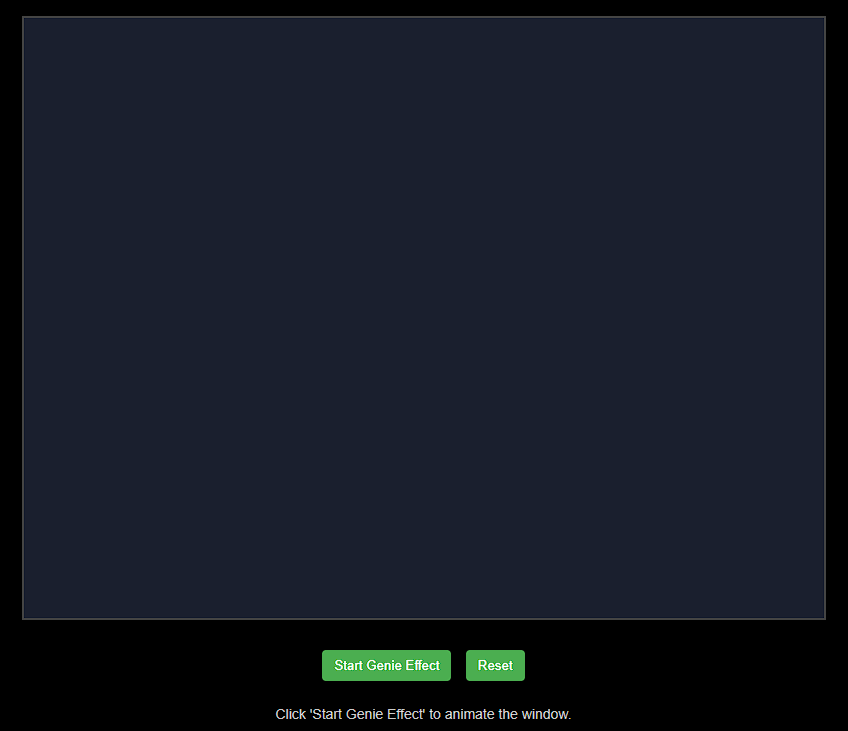

# MacOS Genie Effect with WebGPU

本项目基于 WebGPU 在 web 中实现 `MacOS Genie Effect`，这是 macOS 系统中经典的窗口最小化动画效果。


## 介绍

MacOS Genie Effect 是苹果操作系统中一个标志性的窗口最小化动画效果，窗口在最小化时会像被"吸入"Dock一样进行变形收缩。该效果因其流畅自然的动画而广受赞誉。

本项目使用 WebGPU 技术在浏览器中重现了这一经典动画效果，无需任何插件或额外依赖。

## 效果



## 快速开始

### 环境要求

- Node.js (推荐 v18+)
- pnpm (或 npm/yarn)
- 支持 WebGPU 的现代浏览器（Chrome 113+, Edge 113+, Firefox Nightly with flag）

### 安装依赖

```bash
pnpm install
```

### 开发模式

```bash
pnpm dev
```

这将在本地启动开发服务器，通常在 http://localhost:5173

### 构建项目

```bash
pnpm build
```

构建后的文件将位于 `dist` 目录中。

### 预览构建结果

```bash
pnpm preview
```

## 项目结构

```
src/
├── main.ts          # 主入口：WebGPU 初始化、渲染循环、交互
├── genie.ts         # Genie 形变计算（纯函数，不依赖 WebGPU，可单测）
├── html-in-canvas.ts # HTML-in-Canvas 封装 + 三代 API 降级
├── style.css        # 样式
├── shaders/         # WGSL 着色器
│   └── effect/
│       ├── Genie.fragment.wgsl   # 片段：按 UV 采样
│       └── Genie.vertex.wgsl     # 顶点：像素 → NDC
├── wgsl.d.ts        # WGSL 模块声明
scripts/             # 验证脚本（方向矩阵、DPR、交互、即时刷新）
llms.md              # LLMs 技术文档
AGENTS.md            # AI Agent 使用指南
index.html           # HTML 入口
```

## 形变模型

形变计算全部在 `src/genie.ts` 里，是**不依赖 WebGPU 的纯函数**，便于单测与复用。

### 三个"不写死"

| 维度 | 如何泛化 |
|---|---|
| **窗口位置/尺寸** | `from: Rect`，窗口可以是画布上任意矩形，不必等于整块画布 |
| **收缩方向** | `dir: Vec2` 单位向量，支持上下左右与任意斜向 |
| **收缩目标** | `to: Rect`，其宽高即最终尺寸，位置即 Dock 图标/栏的位置 |

### 核心思路

把所有计算投影到**窗口局部坐标系**：以窗口中心为原点，`dir` 为收缩方向，`perp` 为垂直方向。公式只在 `(along, across)` 上运算，所以换方向不需要改任何逻辑。

三个阶段：

1. **曲线阶段**（`curvePortion` 控制占比）：越靠近目标端的顶点收缩越强 → 形成梯形
2. **位移阶段**：窗口中心平移向目标中心
3. **分轴收缩**：x / y 两轴各自趋向目标缩放比

### 用法

```ts
import { computeGenieMesh, createGridTemplate, GENIE_DIRECTIONS } from './genie';

const tpl = createGridTemplate(40, 30);   // 网格模板，可跨窗口复用

const mesh = computeGenieMesh(tpl, {
  from: { x: 200, y: 150, w: 400, h: 300 },   // 窗口当前矩形
  to:   { x: 380, y: 700, w: 48,  h: 20  },   // 收进 Dock 图标
  dir:  GENIE_DIRECTIONS.down,                // 收缩方向
  progress: 0.45,                             // 0..1
  curvePortion: 0.4,
});
// mesh.positions / mesh.uvs / mesh.indices → 直接喂顶点/索引缓冲
```

### 两个已修正的陷阱

这两处都只在**斜向**下暴露，正方向完全正常，因此容易漏测：

1. **缩放比不能"二选一"**
   最初按 `perp` 朝向在"宽度比/高度比"之间二选一。斜向时 `perp` 也是斜的，
   会导致几乎不收缩。改为 x / y 分轴独立缩放。

2. **位移不能用投影分量**
   最初用 `travelAlong = dot(travel, dir)` 再乘回 `dir`，斜向时长度变成
   `|travel|·cos²θ`，方向越斜丢得越多，最终中心对不上目标。
   改为直接用完整的二维位移向量 `(toCx-fromCx, toCy-fromCy)`。

`scripts/genie-unit.mjs` 与 `scripts/genie-offset-test.mjs` 覆盖了 8 方向 ×
多种「窗口≠画布」场景，可在改动后直接回归。

## 技术细节

更多关于 MacOS Genie Effect 的数学原理和实现细节，请查看 [llms.md](./llms.md) 文件。

## 更多

1. [llms](./llms.md)
2. [agents](./AGENTS.md)

# 感谢

1. [细说如何完美实现 macOS 中的神奇效果](https://daniate.github.io/2021/07/27/%E7%BB%86%E8%AF%B4%E5%A6%82%E4%BD%95%E5%AE%8C%E7%BE%8E%E5%AE%9E%E7%8E%B0macOS%E4%B8%AD%E7%9A%84%E7%A5%9E%E5%A5%87%E6%95%88%E6%9E%9C/)